<div align="center">

**English** · [简体中文](docs/readme/README_zh.md)

# REM: Reverse Engineering Marketing

### One skill that turns anyone's last month of social posts into a playbook you can copy.

**See a creator or brand you like. Understand how their marketing works, post by post.**

[](skills/rem-reverse-engineering-marketing/SKILL.md)
[](https://monid.ai)
[](#what-you-can-analyze)
[](LICENSE)

[Quick start](#quick-start) · [How REM works](#how-rem-works) · [What you get](#what-you-get) · [What you can analyze](#what-you-can-analyze) · [Showcases](#showcases) · [FAQ](#faq) · [Documentation](#documentation)

**Setup:** add the [Monid MCP](https://monid.ai/docs/guide/quickstart-mcp), then give your agent the [skill file](https://github.com/TurboGuo/rem-reverse-engineering-marketing/blob/main/skills/rem-reverse-engineering-marketing/SKILL.md)

</div>

<div align="center">

<br />

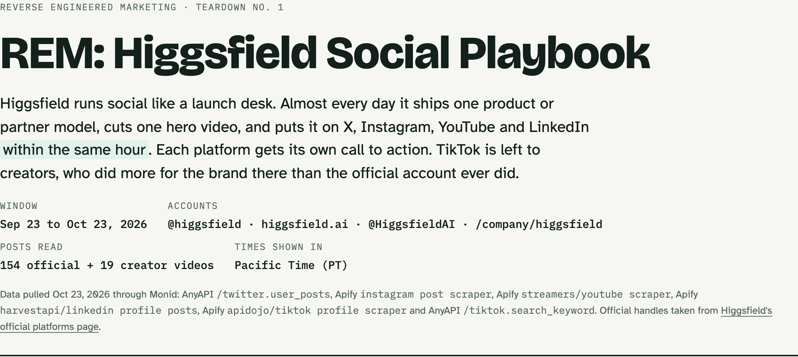

<br /><br />

</div>

---

See a brand growing fast on social and want to know exactly what they do? Ask your agent to run REM on them. It pulls every post from the last 31 days on every platform, sorts the posts into content types, breaks each post into its parts (hook, proof, offer, call to action), and publishes one interactive page that shows how much they post, when, what about, and how each kind of post is built.

Every recipe on the page is a real post from the target, not a fill in the blanks template, and each one comes with a prompt you can paste into an AI video tool to make that kind of video. Every number comes with its source.

## Quick start

### 1. Add the Monid MCP

REM gets all its data from Monid. Install the [Monid MCP](https://monid.ai/docs/guide/quickstart-mcp) in your agent yourself.

### 2. Give your agent the skill

Paste this link into your agent and ask it to use or install the skill:

```text
https://github.com/TurboGuo/rem-reverse-engineering-marketing/blob/main/skills/rem-reverse-engineering-marketing/SKILL.md
```

### Ask your agent

```text
REM @rowancheung
```

```text
Reverse engineer Higgsfield's social media from the last month and give me the playbook.
```

Replace the name with any person or company.

## How REM works

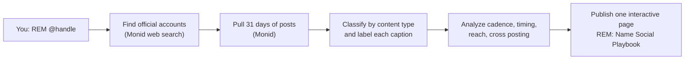

1. **Find the accounts.** Monid web search (search1api `/search`) finds the official handles (company sites usually list them in `sameAs`; people list them on a personal site or LinkedIn).
2. **Pull the month.** Monid endpoints return posts, timestamps and metrics for every platform. A full run has cost well under $1.
3. **Label.** Each post gets a content type, and its caption is split into parts with [`caption_labeler.py`](skills/rem-reverse-engineering-marketing/scripts/caption_labeler.py).
4. **Analyze.** Posts per day, peak hours in PT, average and median reach per type, the same post across platforms, where the link lives, paid partner tags.
5. **Publish.** One HTML page with the sections below, plus a short chat summary with the math and sources.

## What you get

| Section | What it shows |
| --- | --- |
| One day at [Name] | The whole month folded into one day: which hours each platform posts in, and what it mostly posts then |
| An average week | Mon to Sun: each day's regular slots, with the hour, the platform, how often it happened and the usual post type |
| The overall playbook | Posts per day per platform, peak times and a one line note |
| What they post about | 6 to 8 themes, each backed by a number |
| Platform by platform | Clickable content types; each opens a real post split into labeled parts, plus a copyable prompt to make that kind of video, platform notes and top posts |
| Content calendar | Every post on a month grid, colored by type, with platform and type filters |

<div align="center">
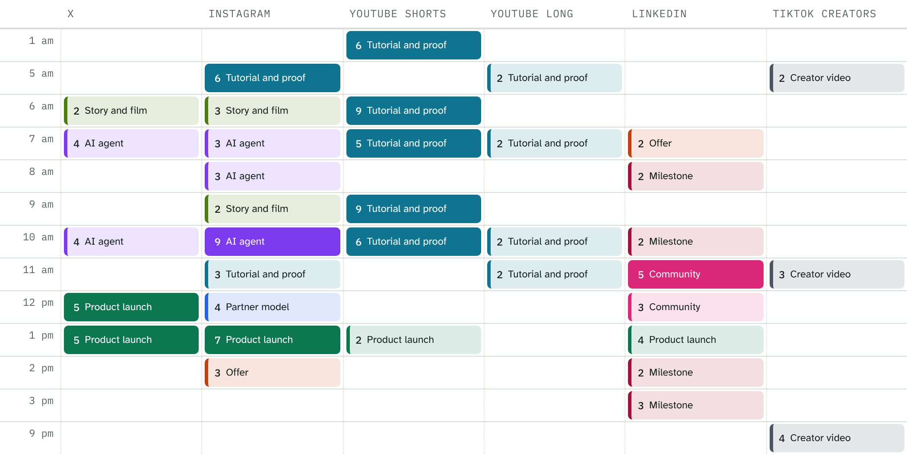
<br /><sub>One day at Higgsfield: the month folded into a single day</sub>
<br /><br />
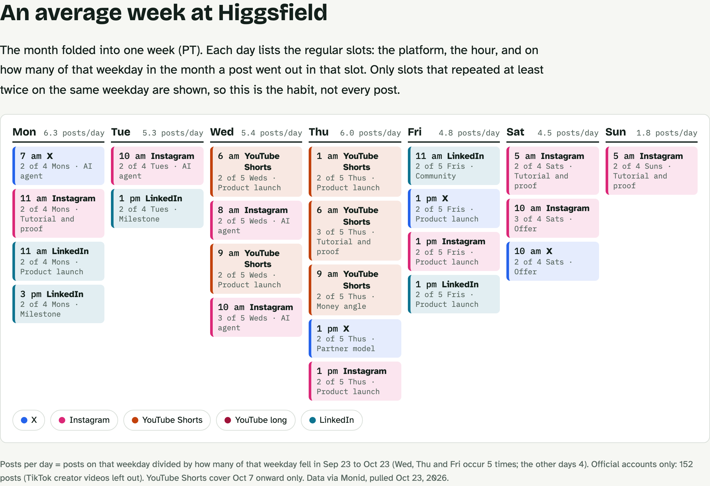
<br /><sub>An average week: the regular slots for each weekday</sub>
<br /><br />
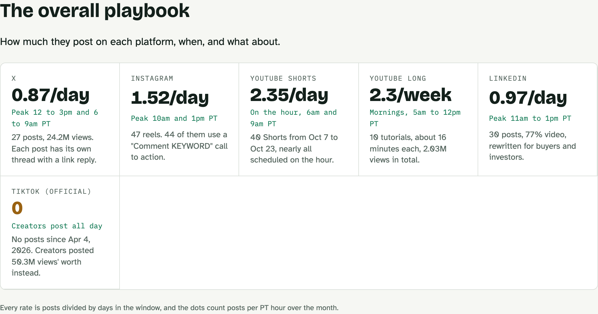
<br /><sub>The overall playbook: how often and when each platform posts</sub>
<br /><br />
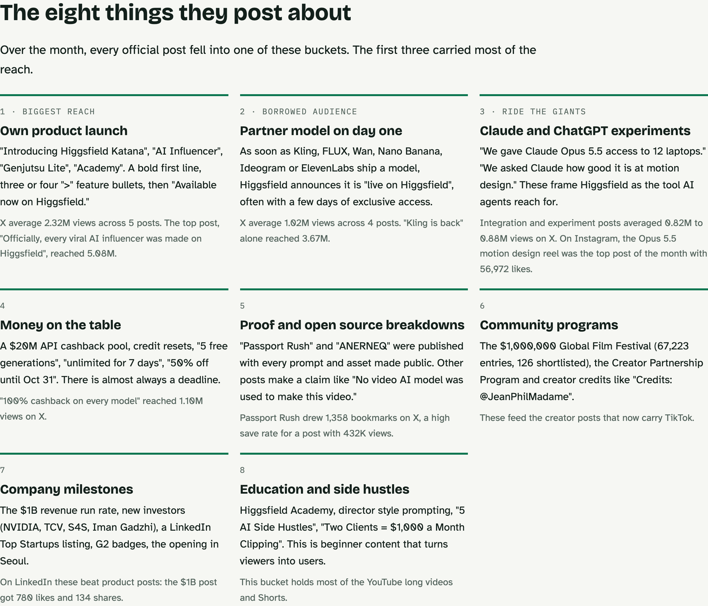
<br /><sub>What they post about: the themes, each backed by a number</sub>
<br /><br />
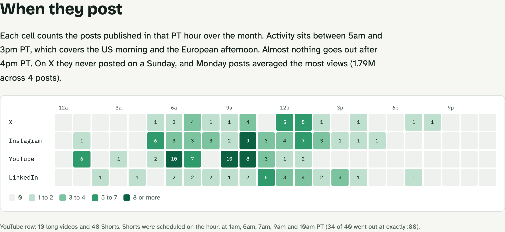
<br /><sub>When they post: posts per hour of day, by platform</sub>
<br /><br />
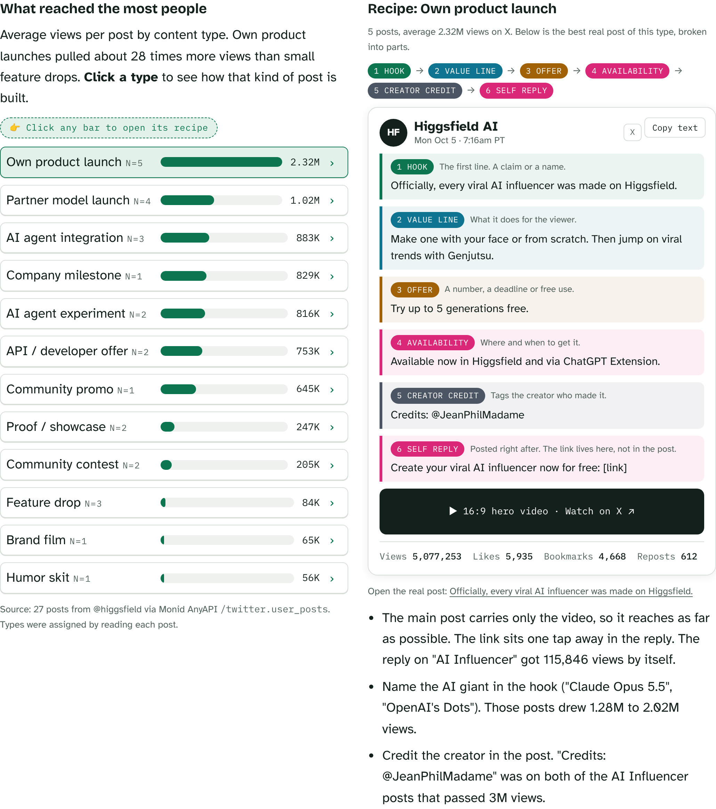
<br /><sub>Platform by platform: click a content type, see a real post broken into labeled parts</sub>
<br /><br />
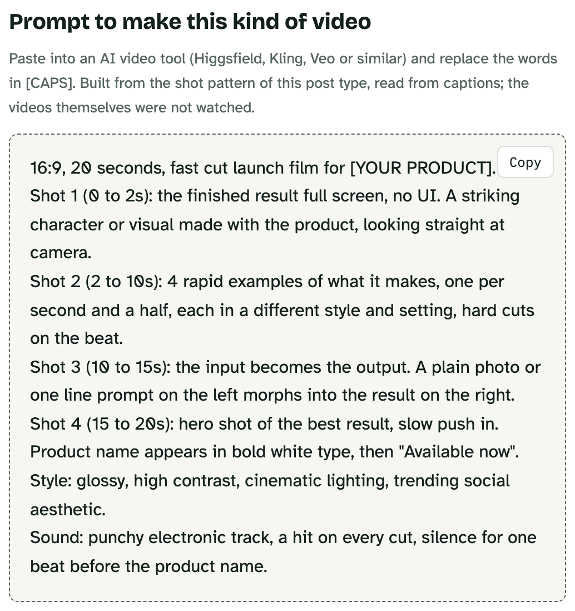
<br /><sub>A copyable prompt to make that kind of video, for every content type</sub>
<br /><br />
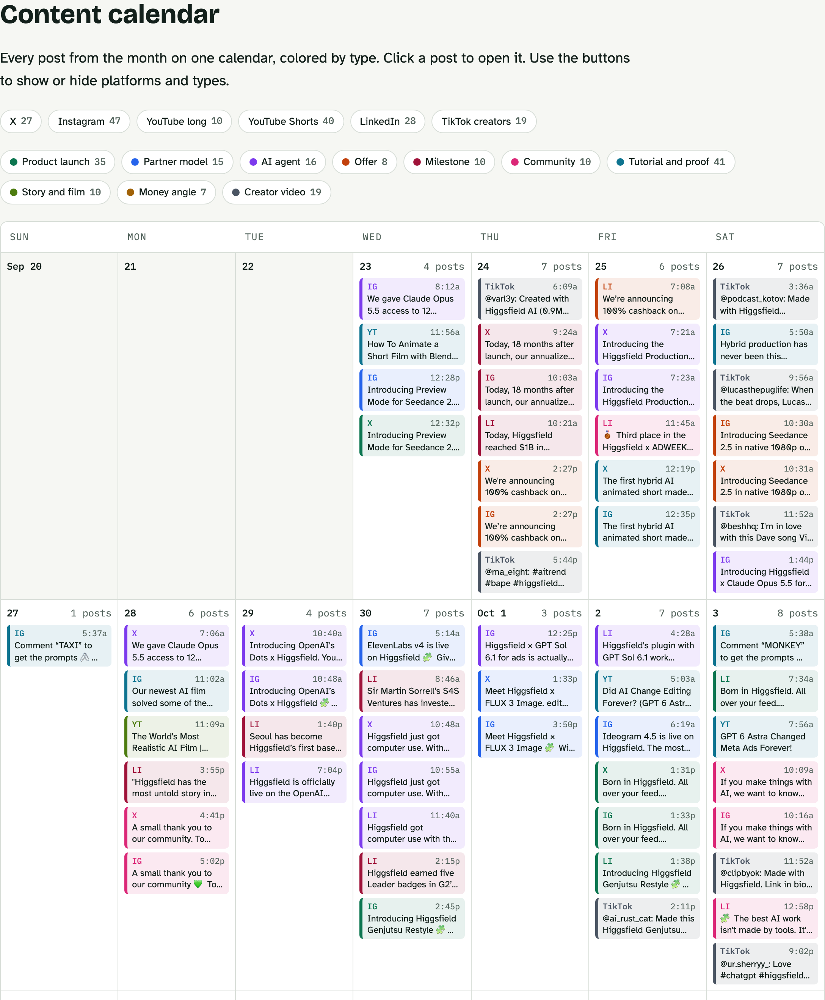
<br /><sub>Content calendar: every post of the month, colored by type</sub>
</div>

<a id="what-you-can-analyze"></a>

## What you can analyze

| Platform | What REM returns | Monid endpoint |
| --- | --- | --- |
| X | Original posts, self reply links, replies, views, likes, bookmarks | anyapi `/twitter.user_posts` |
| Instagram | Reels and posts, captions, likes, comments, keyword calls to action | apify `/apify/instagram-post-scraper` |
| TikTok | Official videos with length and views; top creator videos for the brand | apify `/apidojo/tiktok-profile-scraper`, anyapi `/tiktok.search_keyword` |
| YouTube | Long videos and Shorts, titles, descriptions, chapters, views | apify `/streamers/youtube-scraper` |
| LinkedIn | Company or personal posts, reposts, likes, comments, shares | apify `/harvestapi/linkedin-profile-posts` |
| Threads | Posts and engagement | anyapi `/threads.user_posts` |
| Facebook | Page posts | anyapi `/facebook.profile_posts` |

See [Monid endpoints](docs/monid-endpoints.md) for inputs and known quirks.

## Showcases

### Higgsfield: a launch desk that posts everywhere in the same hour

171 posts across X, Instagram, YouTube, LinkedIn and TikTok creators. Own product launches averaged 2.32M views on X, about 28 times more than small feature drops (2,317,034 ÷ 83,781 = 27.7). 44 of 47 Instagram reels use a "Comment KEYWORD" call to action. The official TikTok was idle, while the top 19 creator videos tagged Higgsfield reached 50.3M views.

### Rowan Cheung: three posts that do the work of thirty

Only 3 original X posts in a month, but a copy and paste list of Grok Bot routines reached 657,263 views with more bookmarks than likes (3,162 ÷ 2,610 = 1.21 saves per like). TikTok runs a science and robotics explainer every weekday; LinkedIn carries paid launch posts.

<div align="center">
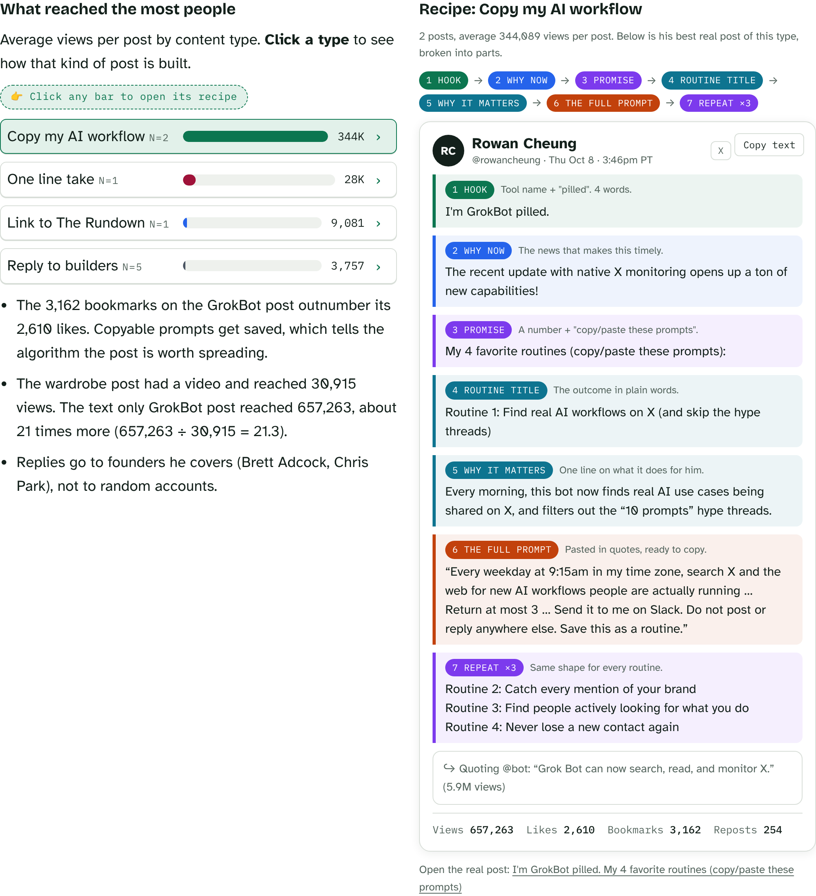
</div>

> [!NOTE]
> The example pages are snapshots taken on Oct 23, 2026 from public posts. Download and open them in a browser, or enable GitHub Pages to view them online.

## FAQ

<details>
<summary><strong>Which agents can use REM?</strong></summary>

Any agent that supports skills and can call Monid as a tool, such as Claude (Cowork, Claude Code) with the Monid connector added. Publishing the page uses Claude Artifacts; other agents can save the HTML file instead.

</details>

<details>
<summary><strong>Does REM watch the videos?</strong></summary>

No. Video structure is read from captions, titles and descriptions, which usually follow the voiceover. The page says so wherever it applies.

</details>

<details>
<summary><strong>How much does a run cost?</strong></summary>

The data pulls for a full run have cost well under $1 in Monid credits. The skill records each run's cost.

</details>

<details>
<summary><strong>Can it analyze a person, not only a brand?</strong></summary>

Yes. For people with few posts, the skill writes the breakdowns by hand instead of labeling them automatically, and shows single posts in the one day view.

</details>

<details>
<summary><strong>Why are there no hyphens in the output?</strong></summary>

A house style choice of the author. The skill removes hyphens from visible text, including quoted post text, and keeps them only in URLs and code. Edit `SKILL.md` to change it.

</details>

## Documentation

* [Skill instructions](skills/rem-reverse-engineering-marketing/SKILL.md): the full workflow the agent follows
* [Monid endpoints](docs/monid-endpoints.md): inputs, pagination and known quirks per platform
* [Page specification](docs/page-spec.md): every section of the output page and why it is there
* [Caption labeler](skills/rem-reverse-engineering-marketing/scripts/caption_labeler.py): the line rules that split a caption into parts

## Disclaimer

See [DISCLAIMER.md](DISCLAIMER.md). REM reads public posts to study marketing patterns. Use it to learn structure and timing, not to copy someone's words or pass off their work as yours.

## License

[MIT](LICENSE)
