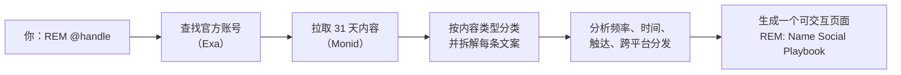

<div align="center">

[English](../../README.md) · **简体中文**

# REM：逆向工程营销

### 一个技能，把任何人最近一个月的社媒内容变成可以直接照抄的打法手册。

**看到一个你喜欢的博主或品牌？逐条拆解他们的营销是怎么做的。**

[](../../skills/rem-reverse-engineering-marketing/SKILL.md)
[](https://monid.ai)
[](#可以分析什么)
[](../../LICENSE)

[快速开始](#快速开始) · [工作原理](#工作原理) · [输出内容](#输出内容) · [可以分析什么](#可以分析什么) · [案例](#案例) · [常见问题](#常见问题) · [文档](#文档)

<code>npx skills add TurboGuo/rem-reverse-engineering-marketing</code>

</div>

<div align="center">

<br />


<br /><br />

</div>

---

看到一个品牌在社媒上涨得很快，想知道他们到底怎么做的？让你的 Agent 对它跑一次 REM。它会拉取对方最近 31 天在所有平台上的每一条内容，按内容类型分类，把每条内容拆成几个部分（开头钩子、证据、福利、行动号召），然后生成一个可交互的页面：发多少、什么时候发、发什么、每类内容怎么写。

页面上的每个"配方"都是对方真实发过的一条内容，不是填空模板。每个数字都标注了来源。

## 快速开始

### 安装技能

装好 Node.js 后运行：

```bash
npx skills add TurboGuo/rem-reverse-engineering-marketing
```

也可以直接把 [`skills/rem-reverse-engineering-marketing`](../../skills/rem-reverse-engineering-marketing) 复制到你的 Agent 技能目录（Claude Code 是 `~/.claude/skills/`）。

REM 需要在 Agent 里接入两个连接器：

* **[Monid](https://monid.ai)**：拉取社媒数据（X、Instagram、TikTok、YouTube、LinkedIn、Threads、Facebook）
* **[Exa](https://exa.ai)**：查找官方账号

### 直接对 Agent 说

```text
REM @rowancheung
```

```text
帮我逆向分析 Higgsfield 最近一个月的社媒，给我一份打法手册。
```

把名字换成任何人或公司即可。

## 工作原理



1. **找账号。** 用 Exa 找官方账号（公司官网一般在 `sameAs` 里列出；个人一般写在个人网站或 LinkedIn 上）。
2. **拉数据。** Monid 接口返回每个平台的内容、时间和数据。一次完整分析的数据费用远低于 1 美元。
3. **打标签。** 每条内容归入一个类型，文案用 [`caption_labeler.py`](../../skills/rem-reverse-engineering-marketing/scripts/caption_labeler.py) 拆成几个部分。
4. **分析。** 每天发几条、太平洋时间的高峰时段、每类内容的平均和中位数触达、同一条内容在各平台的发布时间差、链接放在哪里、付费合作标签。
5. **发布。** 生成一个包含以下板块的 HTML 页面，并在对话里给出简短总结、计算过程和来源。

## 输出内容

| 板块 | 展示什么 |
| --- | --- |
| One day at [Name] | 把一个月折叠成一天：每个平台在哪些时段发，主要发什么 |
| 内容日历 | 按月展示每一条内容，按类型着色，可按平台和类型筛选 |
| 整体打法 | 每个平台每天发几条、高峰时间、主要话题和行动号召 |
| 内容主题 | 6 到 8 个主题，每个都有数据支撑 |
| 一条内容，全平台分发 | 追踪同一条内容在各平台的发布时间，精确到分钟 |
| 分平台拆解 | 可点击的内容类型；点开是一条真实内容的分段拆解，下面是热门内容榜和每条内容的拆解（主题、钩子、结构、信息来源、发布时间） |
| 照着做 | 适合小团队的每周计划、检查清单，以及哪些不要照抄 |

<div align="center">

<br /><sub>Higgsfield 的一天：把一个月折叠成一天</sub>
<br /><br />

<br /><sub>点一个内容类型，就能看到一条真实内容被拆成几个部分</sub>
</div>

## 可以分析什么

| 平台 | REM 返回什么 | Monid 接口 |
| --- | --- | --- |
| X | 原创帖、自回复链接、回复、浏览、点赞、收藏 | anyapi `/twitter.user_posts` |
| Instagram | Reels 和帖子、文案、点赞、评论、关键词评论引导 | apify `/apify/instagram-post-scraper` |
| TikTok | 官方视频的时长和播放；品牌相关的热门创作者视频 | apify `/apidojo/tiktok-profile-scraper`，anyapi `/tiktok.search_keyword` |
| YouTube | 长视频和 Shorts、标题、简介、章节、播放 | apify `/streamers/youtube-scraper` |
| LinkedIn | 公司或个人帖子、转发、点赞、评论、分享 | apify `/harvestapi/linkedin-profile-posts` |
| Threads | 帖子和互动 | anyapi `/threads.user_posts` |
| Facebook | 主页帖子 | anyapi `/facebook.profile_posts` |

各接口的参数和已知问题见 [Monid 接口说明](../monid-endpoints.md)。

## 案例

### Higgsfield：一个在同一小时内全平台发布的"发布台"

X、Instagram、YouTube、LinkedIn 和 TikTok 创作者共 171 条内容。X 上自家产品发布平均 232 万浏览，大约是小功能更新的 28 倍（2,317,034 ÷ 83,781 = 27.7）。47 条 Instagram Reels 里有 44 条用了"评论关键词领链接"。官方 TikTok 停更，但带 Higgsfield 标签的前 19 条创作者视频合计 5,030 万播放。

[打开页面](../../examples/higgsfield/index.html)

<div align="center">

</div>

### Rowan Cheung：三条帖子顶三十条

一个月只发了 3 条 X 原创，但一条"可直接复制的 Grok Bot 用法清单"拿到 657,263 浏览，收藏比点赞还多（3,162 ÷ 2,610 = 每个赞对应 1.21 次收藏）。TikTok 每个工作日发一条科学和机器人科普；LinkedIn 承载付费合作的发布内容。

[打开页面](../../examples/rowan-cheung/index.html)

<div align="center">

</div>

> [!NOTE]
> 案例页面是 2026 年 10 月 23 日根据公开内容生成的快照。下载后用浏览器打开，或开启 GitHub Pages 在线查看。

## 常见问题

<details>
<summary><strong>哪些 Agent 可以用 REM？</strong></summary>

任何支持技能、并能调用 Monid 和 Exa 的 Agent，比如接入了这两个连接器的 Claude（Cowork、Claude Code）。发布页面用的是 Claude Artifacts；其他 Agent 可以直接保存 HTML 文件。

</details>

<details>
<summary><strong>REM 会看视频吗？</strong></summary>

不会。视频结构是从文案、标题和简介里读出来的，这些通常和口播一致。页面上凡是涉及的地方都会注明。

</details>

<details>
<summary><strong>跑一次要多少钱？</strong></summary>

一次完整分析的数据费用远低于 1 美元的 Monid 额度。技能会记录每次调用的费用。

</details>

<details>
<summary><strong>能分析个人，而不只是品牌吗？</strong></summary>

可以。对于发得少的个人，技能会手动撰写每条拆解，而不是自动打标签，并在一天视图里显示单条内容。

</details>

<details>
<summary><strong>为什么输出里没有连字符？</strong></summary>

这是作者的写作习惯。技能会去掉可见文字里的连字符（包括引用的原文），只在网址和代码里保留。想改的话编辑 `SKILL.md` 即可。

</details>

## 文档

* [技能说明](../../skills/rem-reverse-engineering-marketing/SKILL.md)：Agent 执行的完整流程
* [Monid 接口说明](../monid-endpoints.md)：各平台的参数、翻页和已知问题
* [页面规范](../page-spec.md)：输出页面的每个板块及其用途
* [文案拆解脚本](../../skills/rem-reverse-engineering-marketing/scripts/caption_labeler.py)：把文案拆成几个部分的规则

## 免责声明

见 [DISCLAIMER.md](../../DISCLAIMER.md)。REM 读取公开内容来研究营销规律。请用它学习结构和节奏，不要照搬别人的文字或把别人的作品当成自己的。

## 许可证

[MIT](../../LICENSE)
